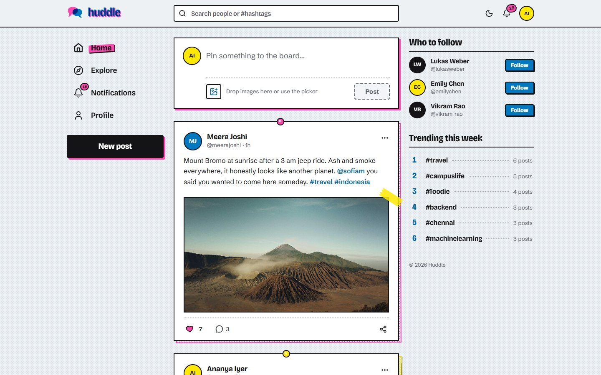
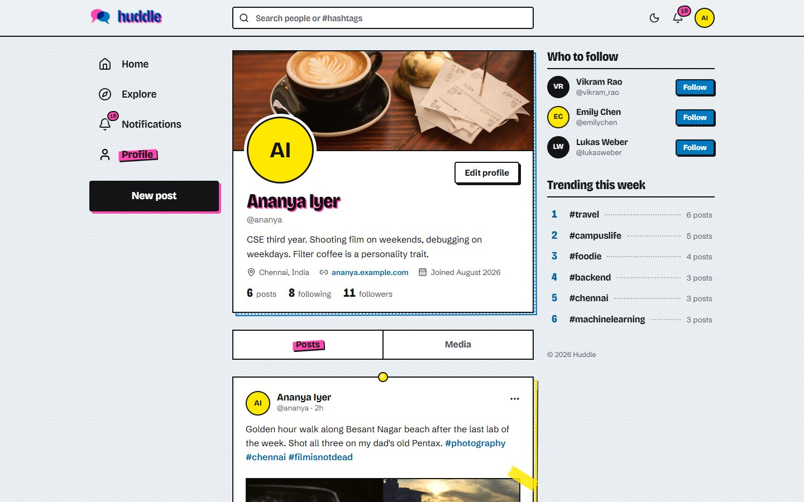
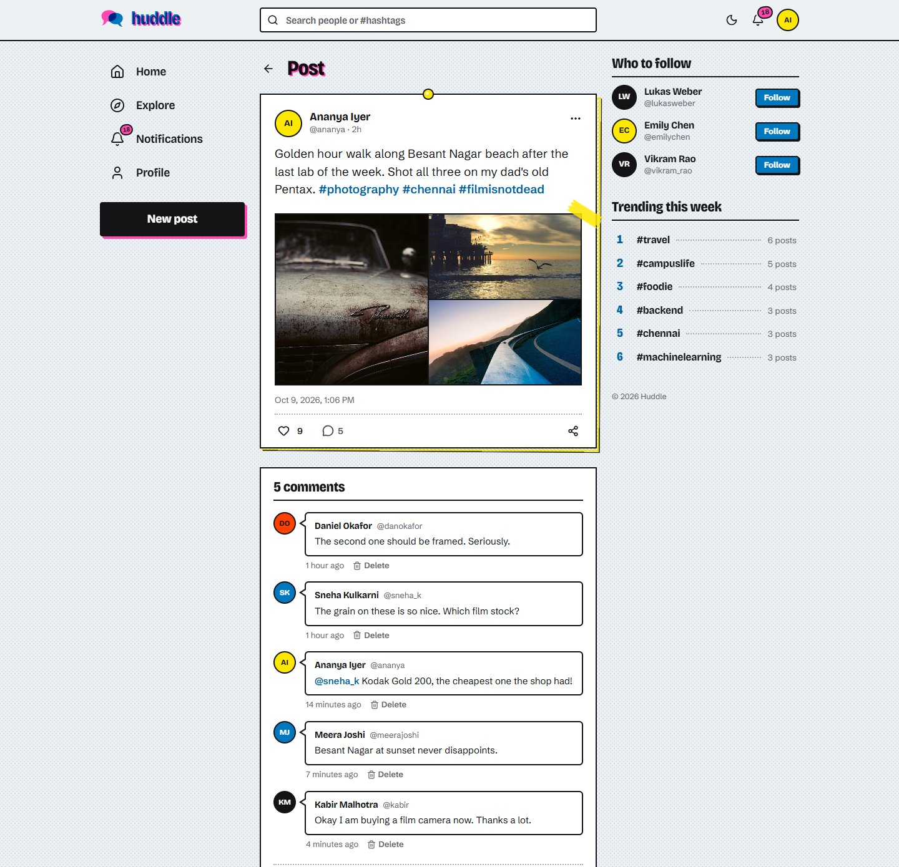
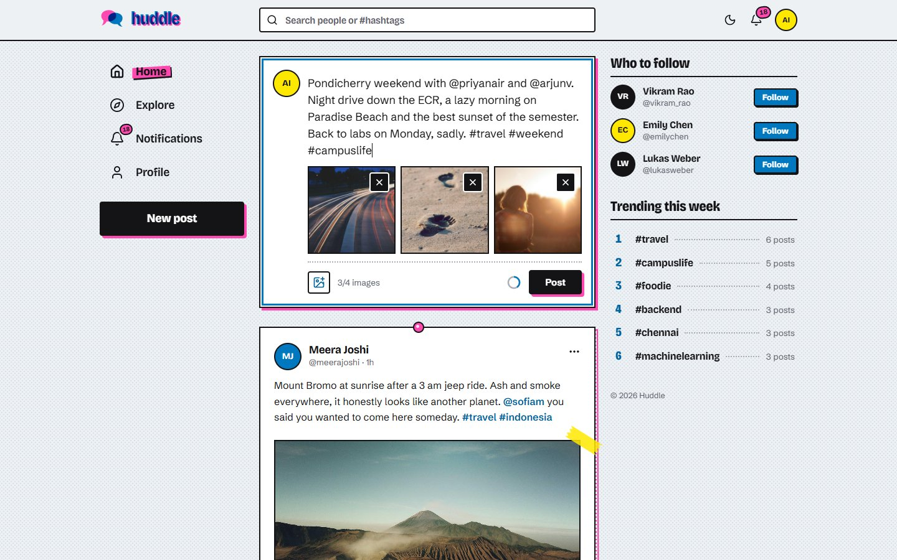
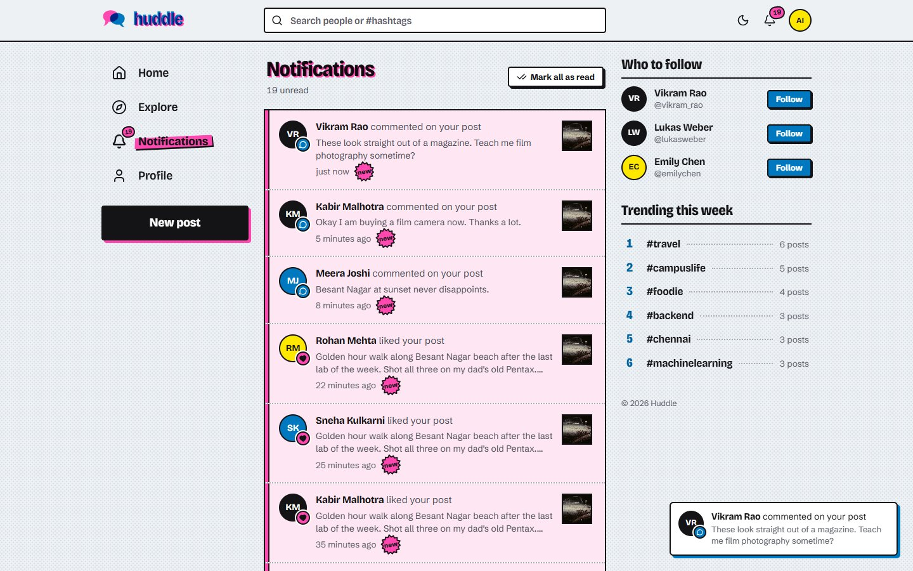
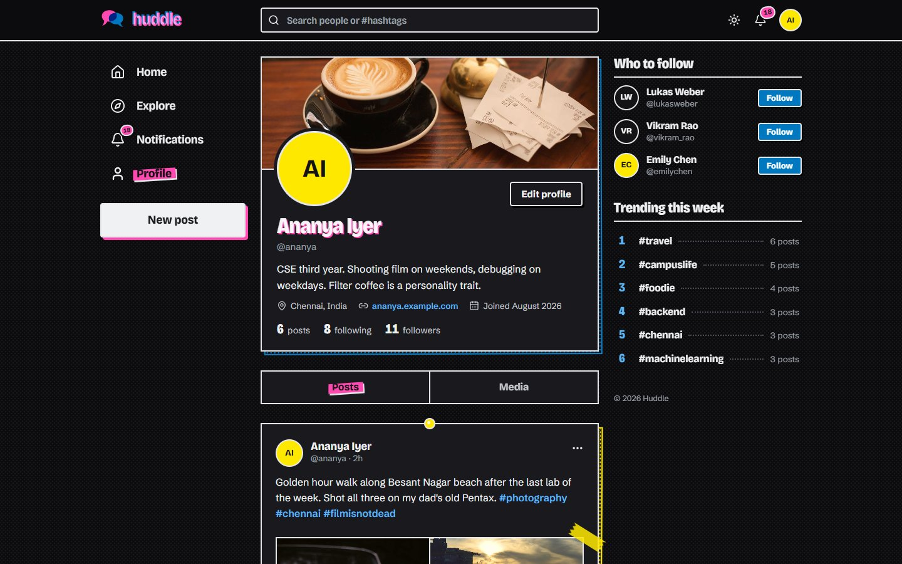
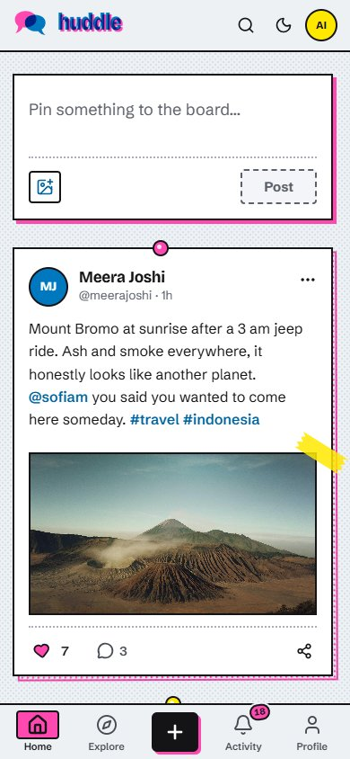
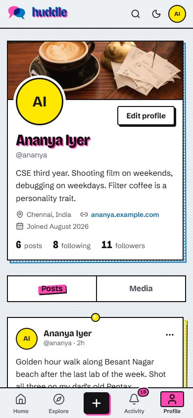
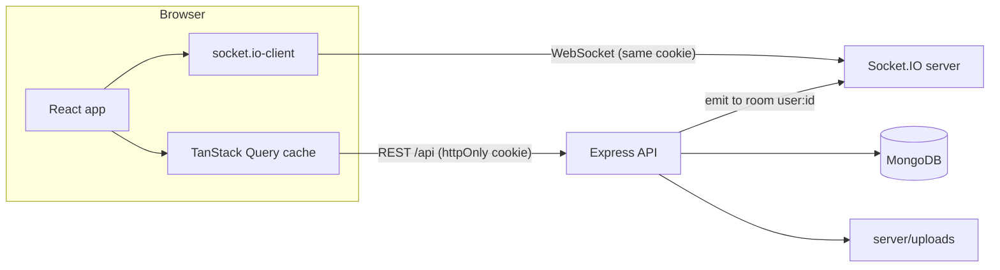
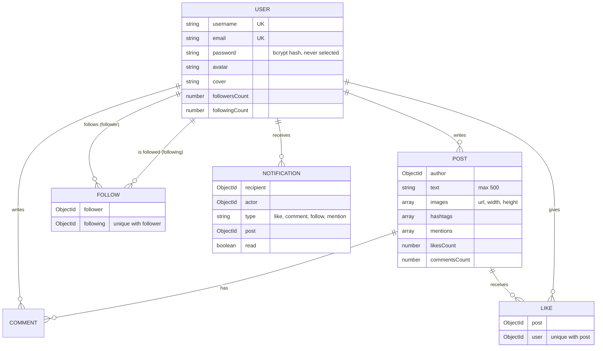

# Huddle

A small social network built on the MERN stack: profiles, posts with photos, likes, comments, and notifications that show up the moment they happen.




I built Huddle during my B.Tech to understand how the parts of a real social app fit together: a feed that pages correctly while new posts keep arriving, likes that can't be double counted, image uploads that are safe to accept, and notifications pushed over WebSockets instead of polled. The demo data is a mix of students and friends from India and abroad posting about campus life, food, travel and code.

## Features

**Accounts and profiles**
- Register with name, username (format rules, reserved names blocked), email and password; log in with email or username
- Session kept in an httpOnly cookie and restored on refresh; protected routes redirect to login
- Profile page with cover image, avatar, bio, location, website, joined date, and Posts / Media tabs
- Follower and following counts open paginated lists; follow and unfollow update instantly (optimistic)
- Edit profile modal with live previews for the new avatar and cover

**Posts**
- Up to 500 characters with a live counter ring, plus up to 4 images (file picker or drag and drop) with a removable preview grid
- Images are resized and converted to WebP on the server; 1 to 4 images get their own grid layout, and clicking one opens a lightbox with arrow-key navigation
- `#hashtags` and `@mentions` become links; hashtags have their own pages, mentions notify the person
- Delete your own posts (with a confirmation dialog); the likes, comments, notifications and image files go with it

**Feed and discovery**
- Home feed of people you follow plus your own posts, newest first, with cursor pagination and infinite scroll
- Explore: trending posts (most engagement in the last 7 days) and a latest tab
- Debounced search in the top bar for people and hashtags, with keyboard navigation; a full search page on phones
- Sidebar with "Who to follow" suggestions and trending hashtags

**Engagement and notifications**
- Likes are idempotent on the server and optimistic in the UI; "Liked by" list for every post
- Comments with pagination; you can delete your own, and post authors can remove comments on their posts
- Like, comment, follow and mention notifications stored in MongoDB and pushed over Socket.IO to the recipient
- Unread badge, a toast when one arrives, a notifications page, and mark all as read (synced across open tabs)
- No notifications for your own actions, and toggling a like on and off does not spam the author

**UI**
- A print-inspired look: the page is a dotted notice board and every post is a flyer pinned to it with a thumbtack, printed in four risograph-style inks (pink, blue, yellow and black) with an offset second plate; photos are taped on and headlines are slightly misregistered
- Three-column layout on desktop, icon rail on tablets, bottom tab bar on phones
- Skeleton loaders, empty states, error states with retry, toasts
- Dark mode that follows the system setting until you pick one, and remembers it
- Native `<dialog>` modals (focus trap and Escape for free), visible focus rings, labelled controls and alt text
- Respects reduced motion and increased contrast settings, and drops the print effects in Windows high-contrast mode

## Screenshots

| Profile | Post with comments |
| --- | --- |
|  |  |
| **Creating a post with images** | **A live notification arriving** |
|  |  |
| **Dark mode** | **On a phone** |
|  |   |

## Tech stack

| Part | What I used |
| --- | --- |
| Client | React 19, Vite, React Router, TanStack Query, axios, socket.io-client, Tailwind CSS v4, lucide-react, sonner |
| Typography | Bricolage Grotesque (headings) and Schibsted Grotesk (body), self-hosted through Fontsource |
| Server | Node.js, Express 5, Mongoose, Socket.IO, JSON Web Tokens, bcrypt, express-validator, multer, sharp |
| Security | helmet (with a CSP), express-rate-limit on auth, CORS with credentials, httpOnly + SameSite cookies |
| Database | MongoDB (local or Atlas), or mongodb-memory-server for zero-setup development |
| Testing | Jest, Supertest and mongodb-memory-server on the server; Vitest for client utilities; ESLint |

## Getting started

### Prerequisites

- Node.js 22.22 or newer on the 22 line, or Node 24 or a later even-numbered release (the odd-numbered 23 and 25 are not supported by the test tooling). I developed on Node 24, and npm comes with it.
- MongoDB is optional. Without it the server runs an in-memory database.

### Install and run (no database needed)

```bash
git clone https://github.com/preransai/huddle.git
cd huddle
npm install
npm run dev
```

Open http://localhost:5173. When `MONGODB_URI` is not set, the server starts an in-memory MongoDB, fills it with demo data and logs:

```
Using in-memory MongoDB: data is reset every time the server restarts.
Seeded 12 users and 61 posts. Log in as ananya@example.com / huddle123
```

The very first start downloads a MongoDB binary for mongodb-memory-server (about 800 MB on Windows, about 130 MB on Linux and 80 to 90 MB on macOS), so give it a few minutes. Later starts take a couple of seconds. `npm run dev` runs the API (port 5000, restarted by nodemon on changes) and the Vite dev server (port 5173) together.

### With a real MongoDB (local or Atlas)

```bash
cp server/.env.example server/.env
# set MONGODB_URI in server/.env, for example mongodb://127.0.0.1:27017/huddle
npm run seed   # optional: wipes the database and loads the demo data
npm run dev
```

### Environment variables

`server/.env` (all optional in development):

| Variable | Default | Notes |
| --- | --- | --- |
| `PORT` | `5000` | API port, and the app port in production |
| `MONGODB_URI` | empty | Empty means in-memory MongoDB. Required when `NODE_ENV=production` |
| `JWT_SECRET` | dev fallback | Required in production; the server refuses to start without it |
| `JWT_EXPIRES_IN` | `7d` | How long a login token stays valid (the cookie that carries it lasts 7 days) |
| `CLIENT_URL` | `http://localhost:5173` | Allowed origin for CORS and Socket.IO |
| `UPLOAD_DIR` | `server/uploads` | Where processed images are written |
| `NODE_ENV` | `development` | `production` turns on secure cookies and the checks above |

`client/.env` is only read by the Vite dev server: `CLIENT_PORT` (default `5173`) and `API_PROXY_TARGET` (default `http://localhost:$PORT`). Running `PORT=4000 CLIENT_PORT=3000 npm run dev` moves both servers, as long as `API_PROXY_TARGET` is not set in `client/.env`.

### Production build

```bash
npm run build                 # builds client/dist
NODE_ENV=production MONGODB_URI="mongodb+srv://..." JWT_SECRET="a-long-random-string" npm start
```

Express serves `client/dist` and falls back to `index.html` for any non-API route, so the whole app runs as a single Node service. On a host that sets `NODE_ENV=production` during the build, use `npm ci --include=dev && npm run build` as the build command (Vite is a dev dependency) and `npm start` as the start command. On Windows PowerShell set the variables with `$env:NODE_ENV="production"` and so on, or put them in `server/.env`. Cookies are marked `Secure` in production, so serve it over HTTPS (Chrome also accepts them on `http://localhost`).

## Demo accounts

Every seeded account uses the password `huddle123`, and you can log in with the email or the username.

| Name | Username | Email | What's interesting |
| --- | --- | --- | --- |
| Ananya Iyer | `ananya` | `ananya@example.com` | Main demo account with unread notifications |
| Rohan Mehta | `rohan_m` | `rohanm@example.com` | Good second account for testing live notifications |
| Priya Nair | `priyanair` | `priyanair@example.com` | |
| Meera Joshi | `meerajoshi` | `meerajoshi@example.com` | Most travel posts |
| Daniel Okafor | `danokafor` | `danokafor@example.com` | |

The others follow the same pattern (the email is the username without underscores, at `example.com`): `arjunv`, `sneha_k`, `kabir`, `vikram_rao`, `sofiam`, `lukasweber`, `emilychen`. The login page also has a one-click demo button.

## Running tests

```bash
npm test            # server and client suites
npm run test:server # Jest + Supertest against an in-memory MongoDB
npm run test:client # Vitest for the client utilities
npm run lint
```

The server suite has 75 tests across auth, posts and uploads, feeds and pagination, likes and comments, profiles and follows, and notifications (including a real Socket.IO client receiving a live event). It starts one mongod for the whole run, gives each test file its own database, and shuts everything down at the end. The client suite has 28 tests for hashtag, mention and link parsing, time and number formatting, and the per-post print styling.

Besides the automated tests, I went through every flow in Chrome with two accounts side by side: registering, following, posting with images, liking, commenting and mentioning, and watching the notifications arrive on the other screen.

## Project structure

```
huddle/
├── client/                  React app (Vite)
│   ├── public/              favicon, theme script that runs before React
│   └── src/
│       ├── assets/          SVG dot screens and halftones for the print look
│       ├── components/      auth, layout, posts, comments, profile, users, notifications, ui
│       ├── context/         auth and theme providers
│       ├── hooks/           post actions, follows, search, notification socket, image attachments, infinite scroll
│       ├── lib/             axios client, query keys, cache helpers
│       ├── pages/           one file per route
│       ├── utils/           text parsing, time and number formatting, print styling (with tests)
│       └── index.css        design tokens (inks, type scale) and the print utilities
├── server/
│   ├── src/
│   │   ├── config/          env and database (in-memory fallback)
│   │   ├── controllers/     auth, posts, likes, comments, users, notifications, tags
│   │   ├── middleware/      auth guard, upload limits, validation, errors
│   │   ├── models/          User, Post, Comment, Like, Follow, Notification
│   │   ├── routes/          route definitions and validation rules
│   │   ├── socket/          Socket.IO setup and per-user rooms
│   │   ├── seed/            demo users, posts and the seeding script
│   │   ├── utils/           pagination, image pipeline, notify, text parsing
│   │   ├── app.js           Express app (used by the server and the tests)
│   │   └── index.js         starts the database, HTTP server and sockets
│   ├── tests/               Jest + Supertest suites
│   └── uploads/             processed images (git-ignored)
├── docs/screenshots/
└── package.json             npm workspaces + scripts for both halves
```

## Architecture



The client only ever talks to one origin. In development Vite proxies `/api`, `/uploads` and `/socket.io` to the Express server; in production Express serves the built client itself, so the cookie and the WebSocket work the same way in both.

### Data model



Likes and follows live in their own collections with unique compound indexes instead of arrays inside `User` and `Post`. Counts are denormalised onto the documents and only change when a `Like` or `Follow` document is actually inserted or deleted. An image `url` is either an absolute URL (the seeded demo photos) or a local path like `/uploads/1760000000000-a1b2c3d4e5f6.webp`, and the client renders both the same way.

## Design decisions

**Cursor pagination instead of skip/limit.** With `skip`, a new post arriving while you scroll pushes everything down by one and the next page repeats a post you already saw. Every list here (feed, profiles, hashtags, comments, likes, followers, notifications) is sorted by `(createdAt, _id)` and the cursor is the position of the last item served, encoded as an opaque string. The next page asks for items strictly older than that, so pages stay stable no matter what gets posted in between. `_id` breaks ties for documents created in the same millisecond. There is a test for exactly this case.

**Notifications go to a room per user.** When the Socket.IO handshake arrives, the server reads the same httpOnly JWT cookie the REST API uses, verifies it and joins the socket to `user:<id>`. Anything that creates a notification just emits to that room. A user with three tabs open has three sockets in the room and all of them update, without the server keeping a map of socket ids. Marking everything as read emits to the same room, so the badge clears in the other tabs too.

**Notifications are deduplicated where it matters.** Like and follow notifications are upserted on `(recipient, actor, type, post)`, so liking and unliking a post ten times creates one notification and one socket event. Comments and mentions are always new events. Nothing is created when you act on your own content, and an @mention of a post's author inside a comment on that post is skipped because they already get the comment notification.

**Idempotent likes and follows.** A like is an upsert guarded by a unique index on `(post, user)`, and `likesCount` only moves when a document was actually inserted or removed. Double clicks, retries and concurrent requests all end with the right count (one test fires five likes at once).

**Optimistic updates on the client.** A post can be cached in several places at once: the home feed, a profile tab, a hashtag page, trending and its own page. Liking it updates every cached copy immediately through one helper (`client/src/lib/cache.js`), rolls everything back if the request fails, then trusts the server's count when it replies. Follow buttons work the same way across profiles, suggestion lists and modals.

**Image pipeline.** Multer keeps uploads in memory with a 5 MB limit, at most 4 files, and a JPG/PNG/WebP/GIF whitelist. Each file then goes through sharp: auto-rotate from EXIF, resize to fit within 1600px (avatars 400px, covers 1500x500), and re-encode to WebP. Re-encoding means a file that only claims to be an image is rejected and EXIF data such as GPS location is stripped. Files are written to `server/uploads` and removed when the post is deleted or the avatar replaced.

**Auth.** Passwords are hashed with bcrypt and the hash is `select: false` on the model, so it never leaves the database by accident. The JWT lives in an httpOnly, SameSite=Lax cookie (Secure in production), which keeps it out of reach of injected scripts and out of cross-site POSTs. Every route that takes input validates it with express-validator, deleting a post or comment checks ownership, auth routes are rate limited, and helmet sets a Content-Security-Policy that only loads scripts from this server and images from this server, local previews and the demo image hosts.

**The print look is a small design system.** Tailwind's default palette, radii and shadows are switched off in `client/src/index.css`, so only the four inks, their overprints (used for status colours) and the board and paper tones exist, and dark mode swaps those tokens rather than individual classes. Each post's ink, tack position, plate skew and tape come from a hash of its id (`client/src/utils/print.js`), so a post looks the same in the feed, on a profile and on its own page. The decoration is kept out of the way of assistive technology: the misregistered copy of a headline is `aria-hidden`, and tacks, tape and plates are hidden in forced-colors mode.

## API overview

All routes are under `/api`. Everything except the auth routes and `/health` needs the session cookie. List endpoints take an optional `cursor` (and `limit`) and return `nextCursor`, which is `null` on the last page.

| Method | Path | What it does |
| --- | --- | --- |
| GET | `/health` | Health check |
| POST | `/auth/register` | Create an account and start a session |
| POST | `/auth/login` | Log in with email or username |
| POST | `/auth/logout` | Clear the session cookie |
| GET | `/auth/me` | Current user, or `null` when logged out |
| GET | `/posts/feed` | Home feed (you + people you follow) |
| GET | `/posts/latest` | Every post, newest first |
| GET | `/posts/trending` | Most engaged posts of the last 7 days |
| GET | `/posts/tag/:tag` | Posts with a hashtag, plus a total |
| POST | `/posts` | Create a post (multipart: `text`, up to 4 `images`) |
| GET / DELETE | `/posts/:id` | Read a post / delete your own |
| POST / DELETE | `/posts/:id/like` | Like / unlike (idempotent) |
| GET | `/posts/:id/likes` | Who liked a post |
| GET / POST | `/posts/:id/comments` | List / add comments |
| DELETE | `/comments/:id` | Delete a comment (its author or the post's author) |
| GET | `/users/:username` | Profile with counts and follow state |
| PATCH | `/users/me` | Update profile fields, `avatar` and `cover` |
| POST / DELETE | `/users/:id/follow` | Follow / unfollow |
| GET | `/users/:id/followers`, `/users/:id/following` | Connection lists |
| GET | `/users/:id/posts?media=true` | A user's posts, optionally only ones with images |
| GET | `/users/search?q=`, `/users/suggestions` | People search and "Who to follow" |
| GET | `/tags/trending`, `/tags/search?q=` | Trending and matching hashtags |
| GET | `/notifications`, `/notifications/unread-count` | Notifications and the badge count |
| POST | `/notifications/read-all` | Mark everything as read |

Socket.IO events (server to client): `notification:new` with the populated notification, and `notification:read-all`.

Errors come back as `{ "message": "..." }` with a matching status code (400 invalid input, 401 not logged in, 403 not yours, 404 missing, 409 duplicate). Validation failures also include an `errors` array of `{ field, message }` that the forms show inline.

## What I'd improve next

- **Uploads on object storage.** Images are written to the server's disk, which is fine on one machine but lost on most hosting platforms when the app redeploys. Cloudinary or S3 would fix that and give resizing on a CDN.
- **Feed fan-out.** The home feed is built on read with `author: { $in: following }`. That's simple and fast at this size, but for accounts following thousands of people a precomputed timeline per user would scale better.
- **More than one server.** Socket rooms live in one process. Running several instances would need the Socket.IO Redis adapter so an event emitted on one server reaches sockets connected to another.
- **Replies, editing and media types.** Comments are flat, posts can't be edited, and only images are supported.
- **End-to-end tests in CI.** The browser checks were run locally with Playwright scripts; they should live in the repo and run on every push.

## License

[MIT](LICENSE), 2026 Preran Sai Yarramasu

Third-party material: the Bricolage Grotesque and Schibsted Grotesk fonts are licensed under the SIL Open Font License 1.1 and the Lucide icons under the ISC License (the icons Lucide derived from Feather are under the MIT License); both are installed from npm and not stored in this repository. The seeded demo data loads avatars from [randomuser.me](https://randomuser.me) and photos from [Lorem Picsum](https://picsum.photos) (Unsplash images) at runtime, and those images belong to their respective owners. The screenshots include the Lorem Picsum photos but not the portraits: they were taken with the app's initials avatars instead.
